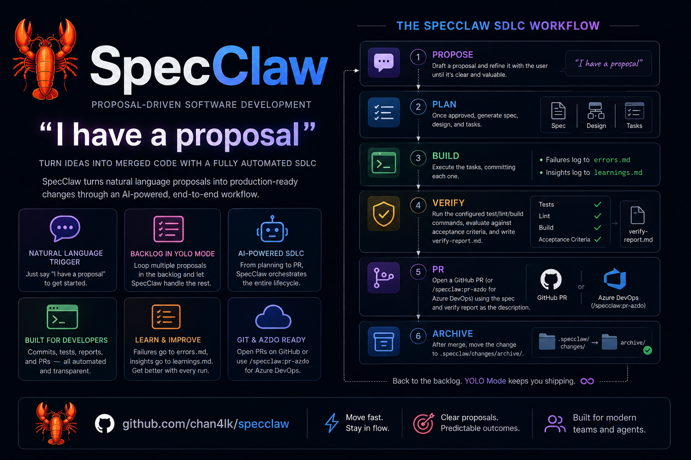

<div align="center">

# 🦞 SpecClaw

### _"I have a proposal."_

**Spec-driven development for Claude Code and Codex.** Turn a plain-English idea into merged, production-ready code through a fully automated SDLC.



[](https://github.com/chan4lk/specclaw/actions/workflows/ci.yml)
[](https://github.com/chan4lk/specclaw/releases)
[](LICENSE)
[](https://claude.com/claude-code)
[](https://github.com/chan4lk/specclaw/stargazers)
[](CONTRIBUTING.md)

</div>

Just say **"I have a proposal"**. SpecClaw takes a change from idea to pull request (propose, plan, build, verify, pr) and keeps a short paper trail in your repo. Every change starts as a mock you can open in a browser, so you see the result before any code is written.

> **Try it:** `/plugin marketplace add chan4lk/specclaw`, `/plugin install specclaw@chan4lk`, `/specclaw:init`

## Install

Requires [Claude Code](https://claude.com/claude-code) v2.1 or later.

```
/plugin marketplace add chan4lk/specclaw
/plugin install specclaw@chan4lk
```

Add-ons from the same marketplace are installed only when you need them:

| Plugin | Adds | Install |
|---|---|---|
| `specclaw` | The lifecycle: init, propose, plan, build, verify, pr, status, archive. In Claude Code it also runs a mod: a changes pane (`/specclaw-pane`), a band above the prompt, a status line entry and a propose gate that warns on edits until a change is approved (see [plugins/specclaw/MOD.md](plugins/specclaw/MOD.md)) | `/plugin install specclaw@chan4lk` |
| `specclaw-bf` | Brownfield rebuilds: analyze, clarify, baseline, replay and rebuild a legacy app (`/specclaw-bf:bf-*`, see [docs/rebuild-workflow.md](docs/rebuild-workflow.md)) | `/plugin install specclaw-bf@chan4lk` |
| `specclaw-sync` | GitHub issues, Azure DevOps boards and PRs, Jira (`/specclaw-sync:*`) | `/plugin install specclaw-sync@chan4lk` |
| `specclaw-extras` | auto, loop, learn, patterns, context, author-spec, debug, renumber and the review panel (`/specclaw-extras:*`) | `/plugin install specclaw-extras@chan4lk` |

All plugins share one version. When your config uses an add-on that is not installed, the session-start hook prints the install command.

**Codex:** `codex plugin marketplace add chan4lk/specclaw --sparse .agents/plugins`, then `codex plugin add specclaw@chan4lk`. In this checkout, Codex also finds the repo-local adapter at `.agents/skills/specclaw/`; invoke it with `$specclaw`.

## Quickstart

```
> /specclaw:init
  Creates .specclaw/ with flow: lean and a blank mock at .specclaw/mock/index.html.

> /specclaw:propose "screen a buyer name against sanction lists"
  Writes changes/001-…/change.md (problem + acceptance criteria) and draws the mock.
  Open .specclaw/mock/index.html#001-… and approve.

> /specclaw:plan 001-…
  Adds the fewest tasks that meet every criterion: UI first, then backend, then integration.

> /specclaw:build 001-…
  One commit per task, at most one test per criterion.

> /specclaw:verify 001-…
  Runs tests, then screenshots the app and the mock (Playwright) or asks you to compare by eye.

> /specclaw:pr 001-…
  Opens the GitHub PR with the change record staged.
```

Change 001 draws the whole app at low fidelity. Each later change edits only its own `<section data-change="…">` in the mock, so the mock always shows what is coming next.

## Lean and full flow

`flow: lean` (the default for new projects) keeps one file per change, `change.md`, and skips the review panel and code-review agents. Set `flow: full` in `.specclaw/config.yaml` for the older flow with `proposal.md`, `spec.md`, `design.md`, `tasks.md` and `verify-report.md`. A config with no `flow` key reads as `full`, so existing projects keep working.

## Project layout

```
.specclaw/
├── config.yaml        # flow, models, git strategy, integrations
├── STATUS.md          # dashboard
├── mock/index.html    # the living mock (lean)
└── changes/<NNN>-<slug>/change.md
```

Scripts in each plugin's `bin/` are on PATH while the plugin is installed. They read and write `.specclaw/` in your project and nothing inside the plugin install.

## Repository

This repo is the `chan4lk` marketplace: `.claude-plugin/marketplace.json` and `.agents/plugins/marketplace.json` list the four plugins under `plugins/`. Each plugin has `.claude-plugin/plugin.json`, `.codex-plugin/plugin.json`, `skills/`, `bin/` and `tests/`. CI runs every `tests/run-*-tests.sh` suite and the shellcheck gate.

## License

MIT. PRs welcome; see [CONTRIBUTING.md](CONTRIBUTING.md).
